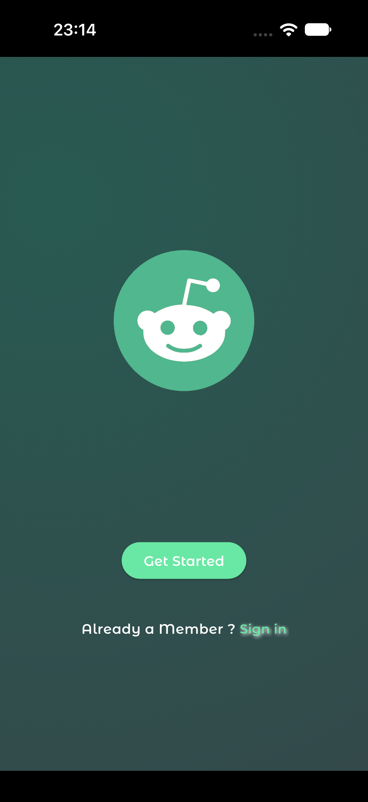
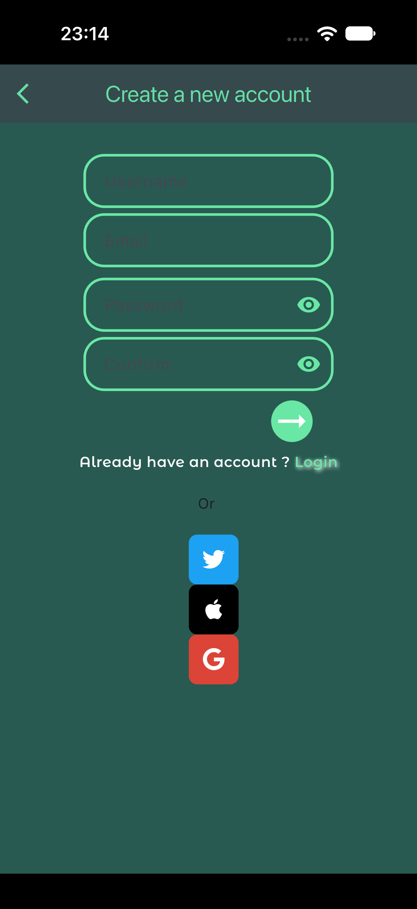
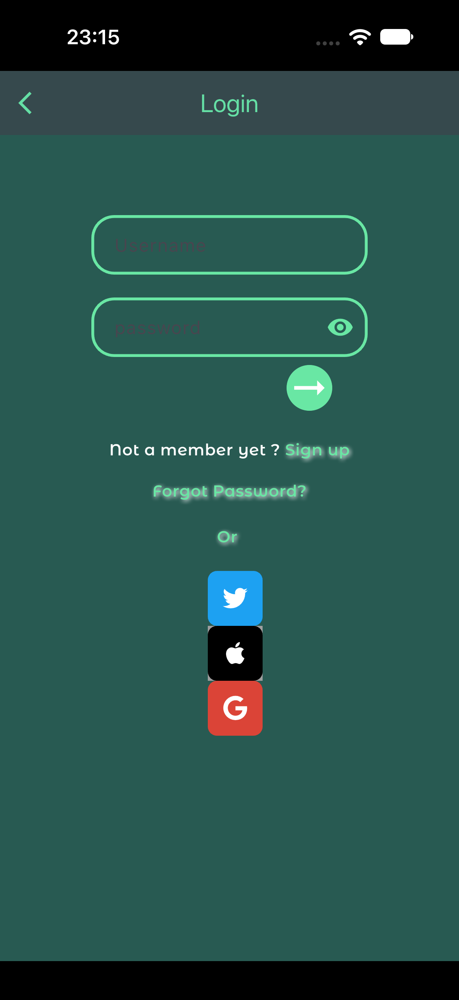
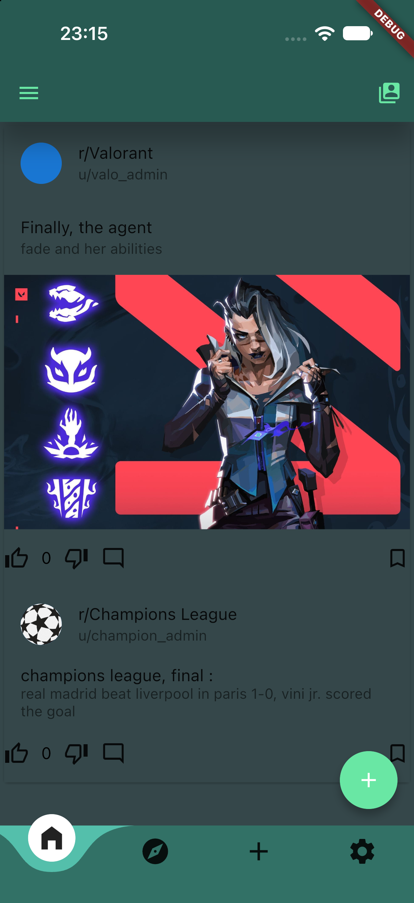
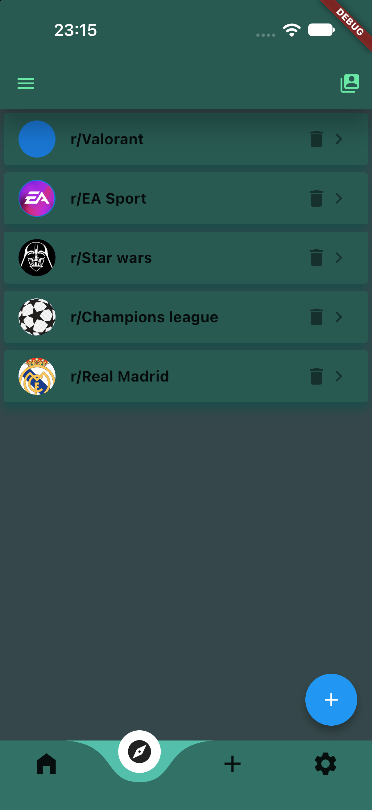
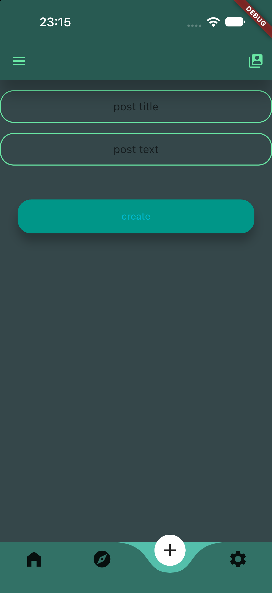
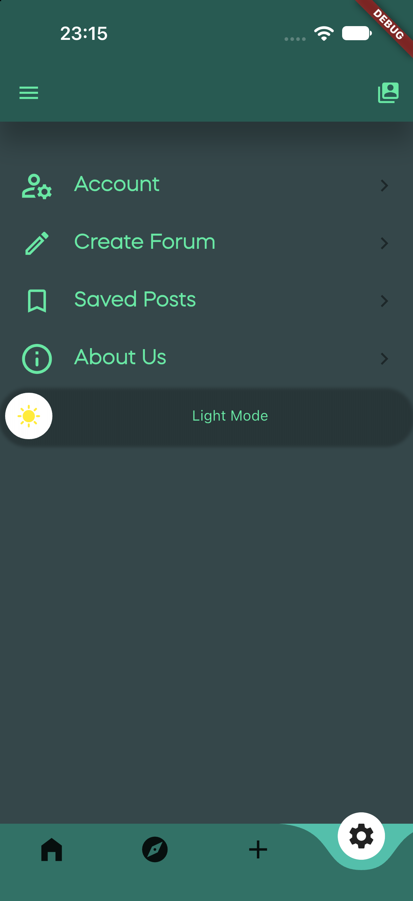

# Reddit583

A "Herelleyyy" version of Reddit: a Flutter UI prototype built as a final Advanced Programming project at SBU. The name refers to the dormitory room number. This is the UI-only version, with no backend.

## Screenshots

| Welcome | Sign up | Login |
|:---:|:---:|:---:|
|  |  |  |

| Home feed | Communities | Create post | Settings |
|:---:|:---:|:---:|:---:|
|  |  |  |  |

## Features

- Animated splash and welcome screen
- Sign up and login forms with validation (username length, password strength, email format)
- Home feed with like, dislike and bookmark on posts
- Community list with add and remove
- Create post and create community screens
- Animated side drawer, curved bottom navigation, settings page with theme toggle

## Getting started

Requires Flutter 3.x (Dart 3).

```bash
cd reddit583
flutter pub get
flutter run
```

Supported targets: Android, iOS, web, macOS.

## Project layout

```
reddit583/lib
├── main.dart          app entry and splash
├── MainClasses/       Post and Community models
├── Screens/           welcome, auth, feed, communities, drawer
└── pages/             account, settings and placeholder tabs
```

## Modernization notes (2026)

Updated from a 2022 Flutter 2 / Dart 2 codebase: null safety migration, Dart 3 SDK, all dependencies upgraded, regenerated Android/iOS/web/macOS platform folders (Gradle 9, Kotlin DSL), replaced the abandoned `flutter_signin_button` with a local `SocialButton`, and moved to the new toggle-switch API. `useMaterial3` is disabled to keep the original look.
