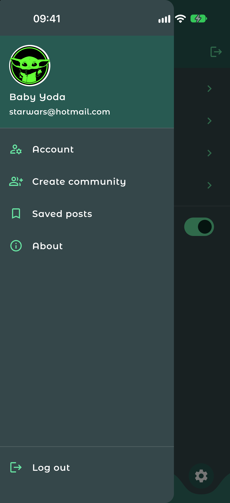

# Reddit583

[](https://github.com/kiarash6k/Reddit583/actions/workflows/ci.yml)


A Reddit-style social app prototype built with Flutter. It started as a final Advanced Programming project at SBU (the name refers to the dormitory room it was built in) and is now a clean, tested UI-only codebase with mock data and no backend.

## Screenshots

| Welcome | Sign up | Login |
|:---:|:---:|:---:|
|  |  |  |

| Feed | Communities | New post |
|:---:|:---:|:---:|
|  |  |  |

| Settings | Drawer |
|:---:|:---:|
|  |  |

## Features

- Welcome, sign-up and login flows with form validation (username, email, password strength, password confirmation)
- Feed with upvote, downvote and save on every post
- Create posts in any community; new posts appear at the top of the feed
- Create and delete communities, with duplicate detection and undo
- Saved posts list
- Light and dark themes, switchable from Settings
- Side drawer, curved bottom navigation, account and about pages

## Getting started

Requires Flutter 3.x (Dart 3).

```bash
cd reddit583
flutter pub get
flutter run
```

Run the checks:

```bash
flutter analyze
flutter test
```

Supported targets: Android, iOS, web, macOS.

## Architecture

State is managed with [`provider`](https://pub.dev/packages/provider). Screens read state from `ChangeNotifier`s and never hold business logic themselves.

```
reddit583/lib
├── main.dart / app.dart   entry point, providers, MaterialApp and routes
├── routes.dart            route name constants
├── theme/                 colour palette and light/dark ThemeData
├── models/                immutable Post, Community and UserProfile
├── data/                  mock data used to seed the app
├── state/                 PostsProvider, CommunitiesProvider, ThemeProvider
├── utils/                 form validators
├── widgets/               reusable UI (PostCard, AppTextField, drawer, ...)
└── screens/               one file per screen
```

## Testing

Unit tests cover validators and providers. Widget tests cover the auth flows, voting and the dark mode switch. CI runs formatting, analysis and tests on every push and pull request.

## License

[MIT](LICENSE)
